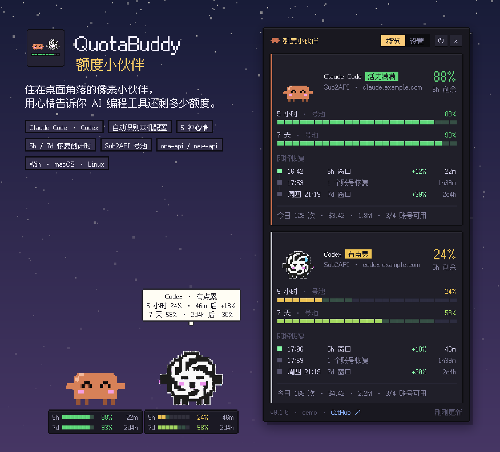
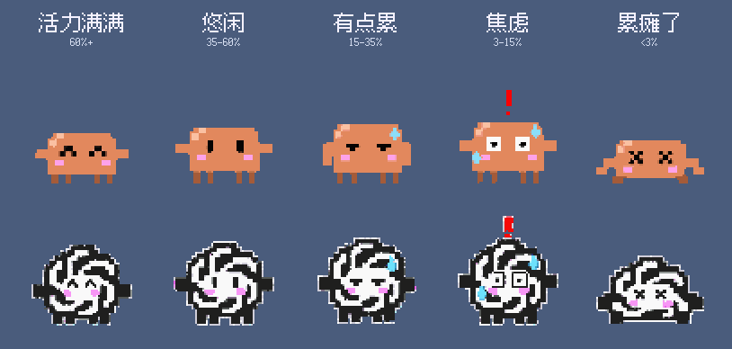
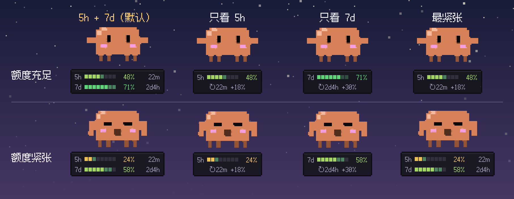
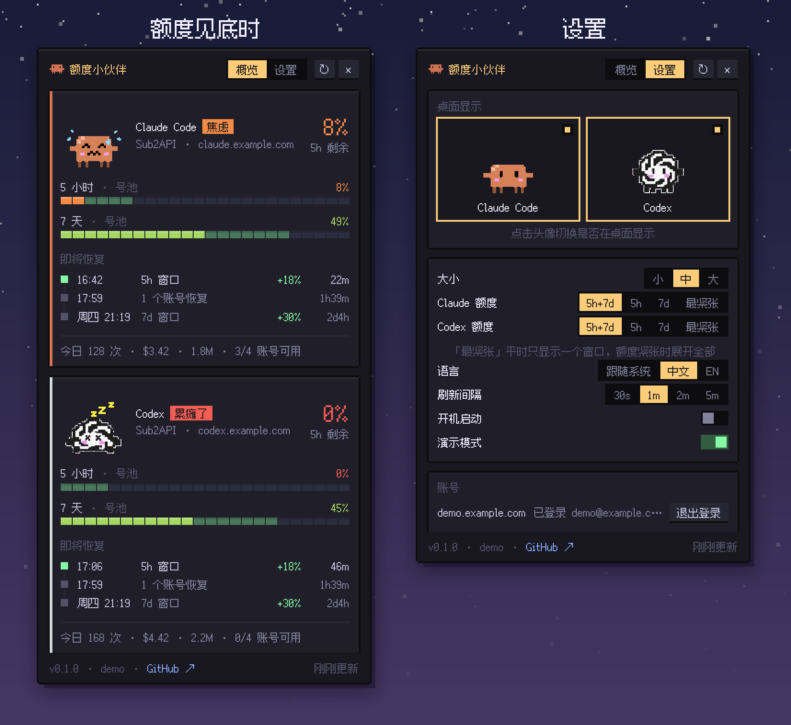

# QuotaBuddy · 额度小伙伴

<p align="center">
  
</p>

住在桌面角落的像素小伙伴，每个 AI 编程工具对应一只，目前有 **Claude Code** 的 Clawd 和 **Codex** 的 GPT。它们会自动读取你本机的配置，查询上游还剩多少额度，然后用心情表现出来：额度充足时蹦蹦跳跳，快用完时冒汗发慌，用光了就趴在地上睡觉，等下一次刷新。

> English summary: pixel desktop pets that read your local Claude Code / Codex configuration, query the upstream quota (official subscriptions, Sub2API, one-api/new-api relays) and show it as moods plus refill countdowns. Windows, macOS and Linux.

## 5 种心情

<p align="center">
  
</p>

心情由最紧张的那个额度窗口的剩余比例决定：

| 剩余 | 心情 | 表现 |
| --- | --- | --- |
| ≥ 60% | 活力满满 | 蹦跳、冒星星 |
| 35–60% | 悠闲 | 呼吸、眨眼、哼歌 |
| 15–35% | 有点累 | 耷拉眼、打哈欠、冒汗 |
| 3–15% | 焦虑 | 发抖、感叹号、狂冒汗 |
| < 3% | 累瘫了 | 趴下、XX 眼、Zzz |

## 桌面额度显示

<p align="center">
  
</p>

小伙伴脚下默认同时显示 **5h 和 7d** 两个窗口，各自带恢复倒计时，一眼就能看出是要等几小时还是几天。每只小伙伴可以在「设置」里单独选择：5h + 7d、只看 5h、只看 7d，或者「最紧张」。选了哪个就显示哪个；「最紧张」平时只显示最紧张的那个窗口，一旦有窗口剩余低于 35%，会把所有窗口都展开。下次刷新能恢复的格子会闪烁提示。

## 面板

<p align="center">
  
</p>

单击小伙伴打开面板。每只小伙伴一张卡片，显示各窗口的剩余比例、「即将恢复」时间线（什么时候、恢复多少、哪些账号回来）和今日用量；数字和进度条变化有过渡动画，打开和关闭都有动效。

## 功能

- **自动识别配置**：不需要手动填写。会依次读取 Claude Code 的 `ANTHROPIC_BASE_URL` / `ANTHROPIC_AUTH_TOKEN`（环境变量、`~/.claude/settings.json`、managed settings、`apiKeyHelper`）、Claude 订阅登录凭据，以及 Codex 的 `~/.codex/config.toml`（`model_provider`、`profile`、`env_key`）和 `auth.json`。
- **桌面宠物交互**：除了小伙伴本身，窗口其他区域都是鼠标穿透的。拖动可以移动位置，单击打开面板，双击立即刷新，右键弹出菜单；悬停会冒出详细信息的气泡，平时也会自言自语。
- **托盘 / 菜单栏**：Windows 托盘提示里显示各自余量；macOS 菜单栏图标旁边直接显示最低余量。右键菜单和托盘菜单可以单独显示 / 隐藏 Claude 或 Codex。
- **设置**：点头像选择桌面上显示哪几只、大小（小 / 中 / 大）、每只小伙伴的额度显示、语言、刷新间隔、开机启动、演示模式，以及 Sub2API 账号管理。

## 支持的上游

| 上游 | 怎么识别 | 能看到什么 |
| --- | --- | --- |
| **Claude Pro / Max 订阅** | `~/.claude/.credentials.json`，macOS 读钥匙串 `Claude Code-credentials` | 5h / 7d 用量与重置时间（另有 Opus、Sonnet 周限额，仅展示） |
| **ChatGPT 登录的 Codex** | `~/.codex/auth.json` 里的 `tokens` | 主窗口和次窗口的用量与重置时间；接口不可用时退回读取最近一次 Codex 会话日志里的限额快照 |
| **[Sub2API](https://github.com/Wei-Shaw/sub2api) 中转** | `GET /v1/usage` 返回 Sub2API 格式 | Key 的余额、总额度、5h/1d/7d 限速和今日用量；**登录账号后**还能看到号池的 5h / 7d 用量、下一次恢复的时间和比例，以及刷新计划。第一次启动会单独弹出登录页（可跳过），之后在「设置 → 账号」里管理 |
| **one-api / new-api 等中转** | `/v1/dashboard/billing/*` | 总额度用量 |
| 按量计费的 API Key（Anthropic / OpenAI / Bedrock / Vertex） | 官方地址加 API Key | 没有额度窗口，小伙伴会一直很开心 |

## 安装与运行

从 [Releases](../../releases) 下载对应平台的安装包：

- **Windows**：`QuotaBuddy Setup x.y.z.exe`（安装版）或 `QuotaBuddy x.y.z.exe`（免安装版）。
- **macOS**：`.dmg`（arm64 和 x64 各一个）。安装包没有签名，第一次打开时请在「应用程序」里**右键 → 打开**；或者执行 `xattr -dr com.apple.quarantine "/Applications/QuotaBuddy.app"`。
- **Linux**：`.AppImage`。

从源码运行（需要 Node.js 22+）：

```bash
npm install
npm start          # 读取本机真实配置
npm run demo       # 演示模式：不需要任何账号，循环展示所有心情
npm test           # 单元测试
npm run dist       # 打包当前平台的安装包到 release/
```

> 国内网络可以先设置 `ELECTRON_MIRROR=https://npmmirror.com/mirrors/electron/` 再安装依赖。

排查问题时可以用 `QB_DEBUG=1 npm start` 启动，终端里会打印上游返回的原始用量数据（不包含任何凭据）。

## 隐私与安全

- 本地配置文件只读不写。API Key 只会发给你配置里的上游地址，不会发往其他任何地方。
- **不会刷新 Claude / ChatGPT 的官方登录令牌**。刷新令牌是轮换的，替 Claude Code 或 Codex 刷新会让它们自己的登录失效。令牌过期时，只会提示你打开一次 Claude Code / Codex。
- Sub2API 的登录凭据（access / refresh token）用系统钥匙串加密后保存（Electron `safeStorage`：Windows 用 DPAPI，macOS 用 Keychain，Linux 用 libsecret / kwallet）。没有可用钥匙串时只保存在内存里。密码不会被保存。
- 如果你给 Node 类 CLI 设置了 `NODE_TLS_REJECT_UNAUTHORIZED=0`，那么只对你配置的中转主机放行自签名证书。

## 美术素材

两个小伙伴的形象由 `gpt-image-2` 生成，再经过脚本还原成干净的像素图：

```bash
# 1. 生成原始精灵表（默认读取 Codex 的 base_url 和 key；也可以用 IMAGEGEN_BASE_URL / IMAGEGEN_API_KEY 指定）
python art/tools/imagegen.py edit --image art/raw/gpt_ref_black.png --image art/raw/clawd_sheet_v1.png \
  --prompt-file art/prompts/gpt_sheet_black_A.md --size 2048x2560 --out art/raw/gpt_sheet_black.png
# 2. 抠图、识别像素网格、按格多数投票取色、统一调色板、去杂边、对齐地面线
python art/tools/build_sprites.py
# 3. README 动图
python art/tools/make_showcase.py
# 4. README 截图（先 npm run build；用演示数据和临时配置截取真实界面，不影响正在运行的实例）
python art/tools/make_screenshots.py
```

所有 prompt 都在 `art/prompts/`，原始生成图在 `art/raw/`。

## 项目结构

```
src/main/        Electron 主进程：配置识别、数据源、轮询、窗口、托盘
  detect/        Claude Code / Codex 配置解析
  providers/     Sub2API、Claude 订阅、ChatGPT、one-api 计费
src/renderer/    桌面宠物窗口（pet）和详情面板（panel）
src/shared/      类型、心情计算、多语言、格式化
assets/          精灵图、像素字体、图标
art/             生成 prompt、原始图和素材处理脚本
test/            node:test 单元测试
```

## 声明

这是非官方的粉丝作品。Claude、Claude Code 和 Clawd 形象是 Anthropic 的商标；OpenAI、ChatGPT、Codex 和 OpenAI logo 是 OpenAI 的商标。本项目与两家公司均无关联，也未获得其认可。代码以 MIT 协议发布；像素字体 [Fusion Pixel Font](https://github.com/TakWolf/fusion-pixel-font) 以 OFL 1.1 协议发布。
